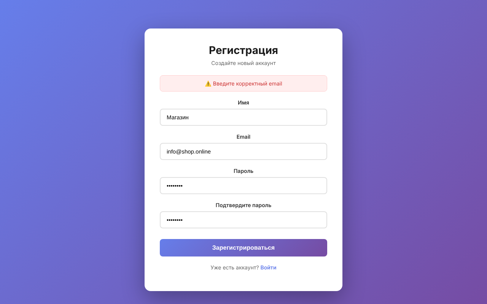
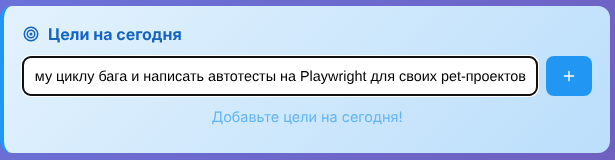
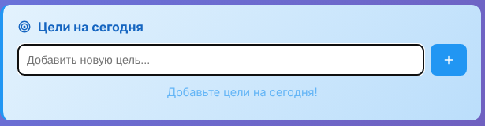
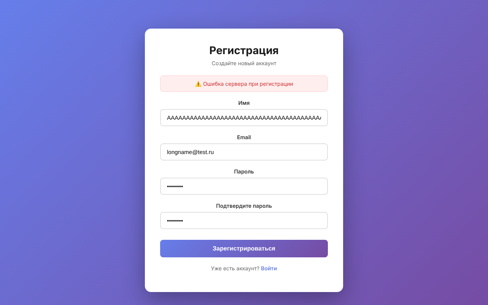
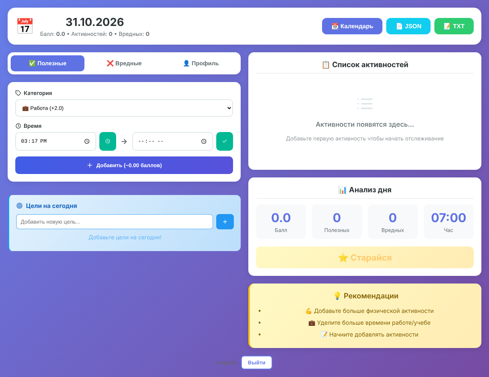

# Баг-репорты — Productivity Tracker

**Окружение для всех багов:** локальный стенд. Backend: Node.js 22, Express, PostgreSQL 16. Frontend: production-сборка React. Браузер: Chromium (Playwright), 1280×900. Версия проекта: коммит `116cc83`. Дата тестирования: 31.10.2026.

**Сводка:** 13 багов — 1 critical, 7 major, 3 minor, 2 trivial.

| ID | Заголовок | Severity | Priority | Где |
|----|-----------|----------|----------|-----|
| [BUG-001](#bug-001) | Регистрация и вход возвращают 500 при настройке по README | Critical | High | Backend / конфиг |
| [BUG-002](#bug-002) | При ошибке 500 во время регистрации аккаунт всё равно создаётся | Major | Medium | Backend |
| [BUG-003](#bug-003) | Email чувствителен к регистру: на один адрес можно создать два аккаунта | Major | High | Backend |
| [BUG-004](#bug-004) | Валидные email-адреса отклоняются (.online, .info, user+tag) | Major | Medium | Backend |
| [BUG-005](#bug-005) | Активность принимает несуществующее время (24:00, 25:99) | Major | Medium | Backend |
| [BUG-006](#bug-006) | Поле даты активности принимает любую строку | Major | Medium | Backend |
| [BUG-007](#bug-007) | Длинная цель: неинформативное «❌ Ошибка», введённый текст стирается | Minor | Medium | Frontend |
| [BUG-008](#bug-008) | Ошибки валидации возвращаются как 500 вместо 400 | Minor | Medium | Backend |
| [BUG-009](#bug-009) | Имя из одних пробелов принимается | Minor | Low | Backend |
| [BUG-010](#bug-010) | В «Анализе дня» без активностей показывается выдуманный «Час: 07:00» | Trivial | Low | Frontend |
| [BUG-011](#bug-011) | Имя пользователя рядом с кнопкой «Выйти» почти не видно (контраст ≈1.1:1) | Trivial | Low | Frontend |
| [BUG-012](#bug-012) | Через PUT можно переписать `userId` и подкинуть запись в чужой аккаунт | Major | High | Backend / безопасность |
| [BUG-013](#bug-013) | Ответ API раскрывает внутренний текст ошибок БД и библиотек | Major | Medium | Backend / безопасность |

---

## BUG-001
**Регистрация и вход возвращают 500, если настроить проект по README**

- **Severity:** Critical — основная функция недоступна
- **Priority:** High — новый разработчик или тестовый стенд не сможет начать работу

**Предусловия:** backend настроен по README проекта: `cp .env.example .env`, заполнены доступы к БД и `JWT_SECRET`.

**Шаги:**
1. Запустить backend командой из README: `npm run dev`.
2. Отправить `POST /api/auth/register` с телом `{"email":"andrey@mail.ru","password":"secret12","name":"Andrey"}`.
3. Отправить `POST /api/auth/login` с теми же email и паролем.

**Ожидаемый результат:** регистрация — `201` и токен, вход — `200` и токен.

**Фактический результат:** оба запроса возвращают `500`.

Регистрация:
```json
{"success":false,"message":"Ошибка сервера при регистрации",
 "error":"\"expiresIn\" should be a number of seconds or string representing a timespan"}
```
Вход:
```json
{"success":false,"message":"Ошибка сервера при входе",
 "error":"\"expiresIn\" should be a number of seconds or string representing a timespan"}
```

**Причина (для разработчика):** код использует `process.env.JWT_EXPIRE` (`authController.js`, функция `generateToken`), но этой переменной нет в `.env.example`.

**Предложение:** добавить `JWT_EXPIRE=7d` в `.env.example` и задать значение по умолчанию в коде.

---

## BUG-002
**При ошибке 500 во время регистрации аккаунт всё равно создаётся**

- **Severity:** Major — в базе остаются «полусозданные» аккаунты, пользователь получил ошибку, но email уже занят
- **Priority:** Medium — проявляется вместе с BUG-001 или при любой другой ошибке после сохранения пользователя

**Предусловия:** окружение из BUG-001 (нет `JWT_EXPIRE`).

**Шаги:**
1. Отправить `POST /api/auth/register` с новым email — ответ `500`.
2. Повторить тот же запрос.
3. Проверить таблицу: `SELECT id, email FROM users;`

**Ожидаемый результат:** при ошибке запись в `users` не создаётся (регистрация в транзакции), повторная попытка ведёт себя так же, как первая.

**Фактический результат:** на шаге 2 — `400 «Пользователь с таким email уже существует»`, в таблице `users` есть запись из шага 1.

**Причина:** пользователь сохраняется в БД до генерации токена, без транзакции.

---

## BUG-003
**Email чувствителен к регистру: на один адрес можно создать два аккаунта**

- **Severity:** Major — дубли аккаунтов, пользователь не может войти, если написал email с заглавной буквы
- **Priority:** High

**Шаги:**
1. Зарегистрировать `andrey@mail.ru`.
2. Зарегистрировать `ANDREY@mail.ru` с другим паролем.
3. Войти как `Andrey@Mail.ru` с паролем из шага 1.

**Ожидаемый результат:** на шаге 2 — `400 «Пользователь с таким email уже существует»`, на шаге 3 вход в аккаунт из шага 1.

**Фактический результат:** на шаге 2 создаётся второй аккаунт (`201`), на шаге 3 — `401 «Неверный email или пароль»`.

**Доказательство:** SQL-проверка №1 в [`sql/data-checks.sql`](sql/data-checks.sql) находит пары `andrey@mail.ru` / `ANDREY@mail.ru`.

**Предложение:** приводить email к нижнему регистру перед сохранением и поиском.

---

## BUG-004
**Валидные email-адреса отклоняются при регистрации**

- **Severity:** Major — часть пользователей не может зарегистрироваться
- **Priority:** Medium

**Шаги:** зарегистрироваться (через UI или API) с каждым из адресов:
- `info@shop.online`
- `info@company.info`
- `user+qa@gmail.com`

**Ожидаемый результат:** регистрация проходит — это корректные адреса.

**Фактический результат:** `400 «Введите корректный email»`, в форме сообщение «⚠️ Введите корректный email».

**Причина:** регулярное выражение `(\.\w{2,3})+$` пропускает только домены из 2–3 букв, а `\w` не включает `+`.



---

## BUG-005
**Активность принимает несуществующее время (24:00, 25:99)**

- **Severity:** Major — портится статистика и баллы пользователя
- **Priority:** Medium

**Шаги:** `POST /api/activities` с токеном:
```json
{"date":"31.10.2026","type":"good","startTime":"25:99","endTime":"99:00","category":"Работа","action":"x"}
```
Повторить со `startTime` и `endTime` = `"24:00"`.

**Ожидаемый результат:** `400`, время должно быть в диапазоне 00:00–23:59. Граница `23:59` принимается.

**Фактический результат:** `201` в обоих случаях. Для 25:99 → 99:00 сервер считает `"duration": 72.35` и `"score": 144.7` (72.35 ч × вес «Работа» 2.0). Сумма часов за день становится больше 24.

**Доказательство:** SQL-проверка №4 находит записи с недопустимым временем, №6 — дни с суммой больше 24 часов.

**Примечание:** в UI поле типа `time` не даст ввести такое значение, но API доступен напрямую, поэтому проверка должна быть на сервере.

---

## BUG-006
**Поле даты активности принимает любую строку**

- **Severity:** Major — записи «теряются»: в БД они есть, а в интерфейсе их не видно
- **Priority:** Medium

**Шаги:**
1. `POST /api/activities` с `"date": "не дата"` → `201`.
2. `POST /api/activities` с `"date": "2026-10-31"` → `201`.
3. Открыть главную страницу за 31.10.2026.

**Ожидаемый результат:** сервер принимает только один формат (интерфейс использует `ДД.ММ.ГГГГ`), остальные — `400`.

**Фактический результат:** обе записи сохраняются. Интерфейс запрашивает `/api/activities/31.10.2026`, поэтому запись с датой `2026-10-31` пользователь не увидит.

**Доказательство:** SQL-проверка №3 находит записи с датами `не дата` и `2026-10-31`.

---

## BUG-007
**Длинная цель: неинформативное «❌ Ошибка», введённый текст стирается**

- **Severity:** Minor
- **Priority:** Medium — пользователь теряет набранный текст и не понимает, что исправить

**Шаги:**
1. Войти в приложение.
2. В поле «Добавить новую цель...» ввести текст из 201 символа или длиннее.
3. Нажать Enter.

**Ожидаемый результат:** поле не даёт ввести больше 200 символов (`maxLength`) или показывает понятное сообщение об ограничении; набранный текст остаётся в поле. Граница: 200 символов сохраняются.

**Фактический результат:** сервер отвечает `400 «Текст цели не должен превышать 200 символов»`, но пользователь видит только всплывающее окно «❌ Ошибка» без причины. После закрытия окна поле пустое.

| До нажатия Enter | После закрытия окна с ошибкой |
|---|---|
|  |  |

---

## BUG-008
**Ошибки валидации возвращаются как 500 вместо 400**

- **Severity:** Minor — пользователь видит «Ошибка сервера» и не понимает, что исправить
- **Priority:** Medium

Каждая строка — отдельный случай для воспроизведения:

| # | Запрос | Ожидаемый результат | Фактический результат |
|---|---|---|---|
| 1 | `POST /auth/register`, имя из 51+ символа | `400`, «Имя должно быть от 1 до 50 символов» | `500` |
| 2 | `POST /auth/register`, пароль из 101+ символа | `400`, «Пароль слишком длинный» | `500` с сообщением **«Пароль должен быть минимум 6 символов»** — текст ещё и неверный |
| 3 | `POST /auth/register`, `"password": 123456` (число, не строка) | `400` | `500` |
| 4 | `POST /activities`, `"type": "neutral"` | `400` | `500` |
| 5 | `GET /activities/single/abc` | `400` или `404` | `500` |

**В UI (случай 1):** пользователь видит «⚠️ Ошибка сервера при регистрации».



**Предложение:** проверять данные до сохранения и возвращать `400` с понятным текстом. Ограничения модели (имя 1–50, пароль 6–100) показывать прямо в форме.

---

## BUG-009
**Имя из одних пробелов принимается**

- **Severity:** Minor
- **Priority:** Low

**Шаги:** `POST /api/auth/register` с `"name": "   "`.

**Ожидаемый результат:** имя обрезается (trim) и не может быть пустым → `400`.

**Фактический результат:** аккаунт создаётся с именем из пробелов (SQL-проверка №2).

---

## BUG-010
**В «Анализе дня» без активностей показывается выдуманный «Час: 07:00»**

- **Severity:** Trivial
- **Priority:** Low

**Шаги:** зарегистрировать нового пользователя и открыть главную страницу.

**Ожидаемый результат:** в карточке «Час» прочерк или «нет данных».

**Фактический результат:** «07:00», хотя активностей нет. Значение подставляется по умолчанию в `DayAnalysis.js`, функция `getBestHour`.



---

## BUG-011
**Имя пользователя рядом с кнопкой «Выйти» почти не видно**

- **Severity:** Trivial
- **Priority:** Low

**Шаги:** войти в приложение и прокрутить страницу вниз.

**Ожидаемый результат:** контраст текста не ниже 4.5:1 (WCAG 2.1 AA).

**Фактический результат:** текст `#666` на фиолетовом фоне (`≈ #705DBB` в этом месте) — контраст ≈1.1:1.

**Причина:** `LogoutButton.js`, `color: '#666'`.


---

## BUG-012
**Через PUT можно переписать `userId` и подкинуть запись в чужой аккаунт**

- **Severity:** Major — нарушение изоляции данных: в чужом аккаунте появляются записи, которые его владелец не создавал
- **Priority:** High — уязвимость безопасности

**Предусловия:** есть два пользователя, A и B. Пользователь A знает id пользователя B (id — последовательные числа).

**Шаги:**
1. От имени A создать активность за `01.11.2026` (`POST /api/activities`), запомнить её `id`.
2. От имени A отправить `PUT /api/activities/{id}` с телом `{"userId": <id пользователя B>}`.
3. От имени B открыть `GET /api/activities/01.11.2026`.

**Ожидаемый результат:** на шаге 2 поле `userId` игнорируется или запрос отклоняется. B не видит чужих записей.

**Фактический результат:** шаг 2 — `200 «Активность обновлена»`. На шаге 3 у B в списке есть активность, созданная A, и она учитывается в его баллах.

**То же для целей:** `PUT /api/goals/{id}` с `{"userId": ...}` переносит цель в чужой аккаунт.

**Причина:** `activityController.updateActivity` передаёт в `activity.update()` всё тело запроса (`req.body`), `goalController.updateGoal` — тоже.

**Предложение:** обновлять только разрешённые поля (whitelist), `userId` брать из токена.

---

## BUG-013
**Ответ API раскрывает внутренний текст ошибок БД и библиотек**

- **Severity:** Major — раскрываются детали устройства системы (ORM, тип БД, библиотеки), это помогает атакующему
- **Priority:** Medium

**Шаги:** `GET /api/activities/single/abc` с токеном.

**Ожидаемый результат:** общее сообщение без технических деталей, например `{"success":false,"message":"Активность не найдена"}`. Подробности пишутся только в лог сервера.

**Фактический результат:**
```json
{"success":false,"message":"invalid input syntax for type integer: \"abc\""}
```
Это текст ошибки PostgreSQL. Также в поле `error` при ошибках регистрации и входа приходят сообщения библиотек: `"Illegal arguments: number, string"` (bcrypt), `"expiresIn" should be...` (jsonwebtoken).

**Предложение:** в блоках `catch` возвращать общий текст и не отдавать `error.message` клиенту.
